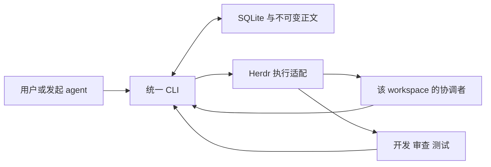

# herdr-team-loop-cli

用 Herdr 运行按 workspace 配置角色的 agent 团队，由统一 CLI 管理需求、派工、证据、Bug 决策和有界修复循环。

- 命令与仓库名均为 `herdr-team-loop-cli`。
- **v0.1 已实现**，Python 3.11+，运行时仅依赖标准库。执行后端需要本机 `hc`；集成核对版本为 0.1.18。
- 任意 agent 可发起初始化；coordinator、developer、reviewer、tester 按 workspace 显式配置，支持候补。
- SQLite 是唯一状态源；正文保存为不可变 artifact。归属为 `workspace → requirement → run → assignment`。

## 安装

在源码目录执行以下任一方式：

```bash
uv tool install .
# 或
pipx install .
```

安装不初始化业务 workspace、不启动模型、不覆盖旧团队 Skill。worker 的启动消息绑定当前 CLI 的 Python 解释器和数据目录。

```bash
herdr-team-loop-cli --help
herdr-team-loop-cli protocol --json
herdr-team-loop-cli agents discover --json
```

发现仅查询 PATH 和显式注册命令，不读取凭据；“已安装”不代表已登录或有额度。

## 在 Herdr 中使用

向任意 agent 提出：

> 使用 herdr-team-loop-cli 初始化当前 workspace，列出本机 agent，让我指定各角色；按 CLI 返回的问题完成初始化。

也可直接提供角色文件，例如：

```json
{
  "coordinator": {"primary": "droid"},
  "developer": {"primary": "codex"},
  "reviewer": {"primary": "droid"},
  "tester": {"primary": "cursor", "fallbacks": ["kimi"]}
}
```

这只是示例，CLI 不会将其作为默认团队。

```bash
herdr-team-loop-cli init --workspace /actual/workspace --json
herdr-team-loop-cli init --workspace /actual/workspace --roles-file roles.json --json
herdr-team-loop-cli requirement create --workspace /actual/workspace \
  --title "本次 E2E" --scope-file scope.md --json
```

使用返回的实际 requirement ID 启动运行；这一步会真实拉起配置的协调者：

```bash
herdr-team-loop-cli run start --workspace /actual/workspace \
  --requirement "$REQ_ID" --mode e2e --environment sc \
  --repo /actual/target-repo --baseline master --json
herdr-team-loop-cli run watch --run "$RUN_ID" --timeout 30 --json
```

默认只测试。明确授权修复时增加 `--repair-policy guarded --authorization-file authorization.json`；有实质业务取舍的 Bug 仍等待具体决定。部署授权单独记录。

完整文件格式与恢复步骤见 [使用指南](docs/usage.md)。随包的 [薄 Skill](src/herdr_team_loop/assets/herdr-team-loop-cli/SKILL.md) 可以从一份权威源软链接到各 agent 的 Skill 目录；不自动覆盖旧 `herdr-team-loop`。

## 执行边界



协调者负责语义判断与推进；CLI 负责归属、状态、授权、预算、资源和证据门禁；Herdr 负责进程与消息。没有常驻调度 daemon，协调会话中断后通过接管继续。

- 每个 requirement 同时只有一个活动 run，每个 run 的 worker 串行；共享代码仓和声明的测试资源跨 workspace 互斥。
- worker 报告和独立验收分开。未解决、未核对或未明确处置的 Bug 阻止完成；延期/否决不等于修复通过。
- 未知投递核对原执行；交接前确认旧进程停止及在途业务结果。进程退出不能证明远端副作用结束。
- SC 证据的完整性和关联由 CLI 检查，平台事实仍需协调者核对。测试夹具 smoke 不代表真实 agent 或业务 SC E2E 已通过。
- 本机同一 OS 用户下的协作隔离，不提供多租户安全隔离或不可伪造的人类签名。

默认数据根目录为 `$XDG_DATA_HOME/herdr-team-loop-cli`，未设置时为 `~/.local/share/herdr-team-loop-cli`。可用 `--data-dir` 或 `HERDR_TEAM_LOOP_DATA` 覆盖；使用本地磁盘并放在目标代码仓外。

## 开发与验证

```bash
PYTHONPATH=src python3 -m unittest discover -s tests -v
uv build
# 可选：只启动临时 Python OSC 夹具，不启动模型
PYTHONPATH=src python3 tools/smoke_herdr.py
```

测试覆盖存储、归属、配置冻结、Git 指纹、CLI、决定门禁、完整修复流程与中断恢复。原生 smoke 使用独立 Herdr session、临时配置和临时仓，不操作现有业务会话。

[已批准设计](docs/design.md) 保留背景，当前接口与限制以使用指南为准。旧任务自动导入、业务 workspace 自动迁移、离线通知和多主机共享数据库不包含在 v0.1。
