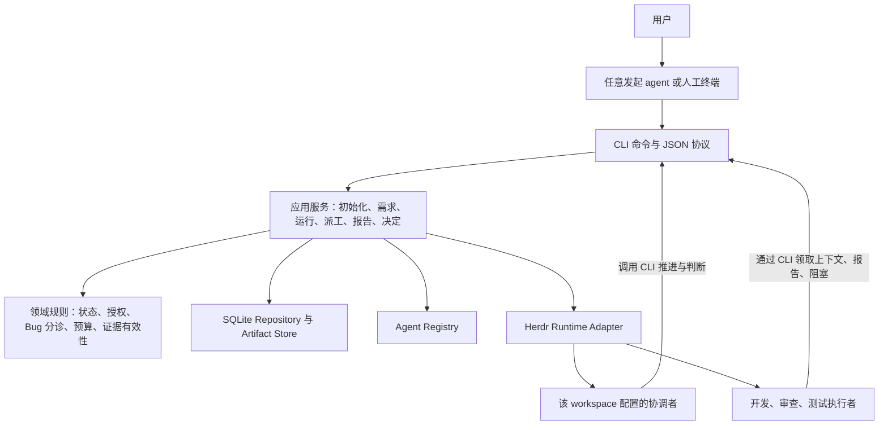

# herdr-team-loop-cli：需求、架构与使用流程

状态：已批准的设计基线，2026-11-08。v0.1 已落地；本文保留原设计推导，实际命令和当前限制见 [使用指南](usage.md) 与 [README](../README.md)。后续迁移、导入等规划不代表已实现。CLI 与 GitHub 仓库名均为 `herdr-team-loop-cli`。

## 1. 已确定的目标与本次建议

### 用户已确定

- 任意 agent 均可在某个物理 workspace 中发起初始化。
- CLI 发现本机 agent 候选，由用户逐项选择角色，或直接应用用户已经提供的角色映射。
- 角色按 workspace 独立配置，不能把 Droid 固定为所有 workspace 的协调者。
- agent 的团队协作统一经过 CLI，任务状态不能由各 agent 直接维护多份文件。
- “只与 CLI 交互”限定于团队协作协议：派工、状态、报告、交接及决定必须经过 CLI；编辑代码、运行项目测试和浏览器验证继续使用 agent 已有业务工具。
- 一个 workspace 中支持多个需求；需求归属和数据存储方式需要明确设计。
- Bug 按是否存在实质性取舍进行分诊：明确且在授权范围内的修复可自主推进；存在业务或方案取舍时先交用户决定。
- 先交付可评审的需求、架构与使用说明，再开始开发。

### 本次建议，供评审确认

- 主层级采用 **workspace → requirement → run**，具体派工使用 assignment。
- 使用本机用户级 SQLite 作为唯一状态源；Markdown 保存可读正文；JSON 作为 CLI 输入输出和导出格式。
- 角色选择与 agent 品牌分离：coordinator、developer、reviewer、tester 映射到不同 AgentProfile。
- v1 复用 Herdr 作为执行后端，由已配置的协调者通过 CLI 推进任务；CLI 实现确定性约束和外部执行协议。
- v1 使用 Python 3.11+，优先标准库 argparse、sqlite3、subprocess、pathlib；适配 macOS/Linux 本机 Herdr。Windows 原生执行后续按真实需求验证。
- 不新增常驻 daemon、模型 API 客户端、通用 DAG、远端多机数据库或插件市场。

## 2. 现状与需要收敛的问题

现有 `team_loop.py` 已具有本地状态命令、版本检查、任务锁、代码指纹、阶段转换、交接和预算限制，相关实现可以复用。

当前不足是：

1. `begin → hc run → bind → 核对投递 → 收证 → record` 依赖协调 agent 按文档逐项串联。
2. 阶段与 Droid/Codex/Cursor/Kimi 的绑定写进代码，无法按 workspace 设置不同团队。
3. 缺少统一的 workspace、需求、Bug、方案和决定模型，任务目录由 PM 临时选取。
4. 任务级 `allow_fixes` 无法表达“某个 Bug 的某项方案尚待用户决定”。
5. SC 部署版本与代码验证之间主要依赖说明，缺少结构化的环境证据门槛。

现有 Skill 和 Herdr 模板已经通过软链接共享一份源文件。改造要统一执行协议和任务数据归属，而不是机械地把所有安装入口搬进一个目录。

## 3. 领域模型与隔离

| 对象 | 含义 | 关键约束 |
| --- | --- | --- |
| Workspace | 一组团队配置绑定的物理根目录 | 使用真实路径注册；稳定 ID 与路径分开；重命名或迁移需显式重新绑定 |
| Requirement | 一个可独立说明目标和验收的需求，也可是一项回归测试任务 | 必须属于一个 workspace；标题不是身份；范围、验收和来源均可版本化 |
| Run | 该需求的一次有界执行 | 固定本次范围、角色配置修订、授权、目标仓、预算和验收输入；恢复不创建新 run |
| Assignment | 一次交给具体执行者的工作 | 归属 run，记录角色、agent、终端、输入和投递状态；交接保留历史并生成新 assignment |
| Bug | 一个需要调查、修复或明确处置的问题 | 归属 requirement；引用发现 run、复现证据、分诊结果、方案及验证证据 |
| FixProposal | 针对某个 Bug 的修复方案 | 有版本、影响范围、预期行为、备选项及推荐理由；决定必须指向确定的版本 |
| Decision | 用户对一个具体取舍的决定 | 绑定 Bug、方案版本和适用范围，保存答复来源；旧决定不能覆盖实质改变后的方案 |
| Artifact / Evidence | 需求正文、计划、报告、日志摘要等可读产物 | 保存来源、范围、摘要和不可变版本；同名覆盖不应改变已接受的结论 |

v1 同一 requirement 同时只允许一个活动 run，等待用户决定也仍属于活动 run。不同需求可并行，但仍须通过共享资源检查。新 run 用于明确的新一次执行；恢复、重试或等待回复不能偷偷创建新 run 以重置预算。

Bug 与 run 通过显式关联记录适用性和本轮验证状态。新 run 会列出该需求历史未解决 Bug，由协调者核对哪些适用于本次范围；尚未核对的必需问题不能被遗漏后直接验收。排除问题须符合用户确定的范围，若改变验收要求则需要对应决定。旧 Bug 的 resolved 标记也不能代替新 run 的版本核对与必要验证。

用户决定可以跨 run 复用，但必须仍覆盖当前问题、方案版本和授权范围，且用户没有限定只适用于某次执行；不能因 run ID 改变而机械重复询问，也不能无条件沿用。

所有关联和查询都带 workspace ID；requirement、run、assignment 的归属链在数据库约束和服务层同时校验。知道另一个 workspace 的 Bug ID，不代表可在当前上下文操作它。

这里的 workspace 隔离是**单机同一用户下的协作数据隔离**，不是多租户安全隔离。目标业务仓可以位于 workspace 外部，但必须显式纳入需求和运行范围。

### 3.1 workspace 如何定位

- 显式 `--workspace <path>` 优先；先解析真实路径，避免软链接形成重复注册。
- 没有显式参数时，可从当前目录匹配最近的已注册祖先 workspace；结果不明确时返回候选，不擅自创建或切换。
- 同一物理路径不能重复注册；同名但不同物理路径属于不同 workspace。
- 移动目录、注册已有目录副本、将 worktree 关联到已有需求均使用明确操作，不按 Git remote 自动合并身份。
- 不在初始化时 checkout、fetch、clone 子仓、安装业务依赖或修改全局 Git 配置。

### 3.2 CLI 如何感知需求

需求通过三种明确动作进入系统：创建、选择已有需求、绑定已有来源。

- 用户给出新目标：agent 整理标题、范围和验收，调用 `requirement create`。
- 用户给出 Jira/其他工单或文档：保存稳定来源标识和内容修订；已有映射时展示已有需求，新建或绑定由本次意图决定。
- 用户说“继续之前的需求”：按当前 workspace 查询候选；无法唯一确定时由 agent 向用户确认。
- 用户仅说“做一次 SC 回归”：可以创建一个显式的测试需求，不要求必须有 Jira 工单。
- 标题相似、当前分支名、最后更新时间只能作为检索线索，不能直接决定归属。

v1 的来源绑定保存链接、外部 ID 和 agent 提供的正文，不内置 Jira/飞书等平台的完整 API 客户端。

**不设置所有 agent 共享的全局“当前需求”。** 每次派工携带 workspace、requirement、run、assignment ID；worker 使用 CLI 提供的绑定上下文，交互用户可显式传入 ID。已有 run 的需求归属不可变。

## 4. 初始化与每个 workspace 的角色配置

### 4.1 被动发现，能力分层

`agents discover` 查询 PATH、内置候选清单和用户显式注册的命令，必要时读取已知模板 frontmatter。它不读取 token、认证文件或浏览器登录资料，不启动模型，也不因枚举模板而自动启动 Herdr core。

本次本机检查发现 Droid、Codex、Cursor Agent、Kimi、Claude、Pi、OMP、OpenCode 的命令入口。发现能力不能保证涵盖任意第三方 agent，因此必须支持 `agents register` 显式补充命令与启动规格。

每个候选分别显示：

- executable 是否存在及实际路径；
- 启动规格是否已配置；
- 首条任务是否验证可投递；
- 是否能通过 CLI 回报；
- 运行状态、停止和恢复行为是否已验证；
- 登录、额度和具体业务工具可用性是否已知。

“已安装”不能推导“已登录、有额度、能够完成任务”。登录与额度状态只能由独立验证或实际执行更新，且需记录时间。

### 4.2 任意 agent 发起 init

```text
用户对任意 agent 提出初始化
  → agent 调用 init --workspace ... --json
  → CLI 返回候选、已有配置、缺少的角色和待回答项
  → agent 把这些选项展示给用户
  → 用户选择，或使用其已明确给出的映射
  → agent 提交完整映射
  → CLI 校验并原子保存该 workspace 的配置修订
```

发起者不自动成为协调者。初始化不要求 `HC_TERMINAL_ID`，也不启动团队。

- JSON/非 TTY 模式：缺信息时返回 `needs_configuration` 和结构化 questions，不阻塞等 stdin。
- 用户直接在 TTY 使用：可进入同一套配置逻辑驱动的交互向导。
- 已有配置：默认返回现状，不静默覆盖；修改通过 `roles set` 等明确命令。
- 角色已在用户指令中明确时，直接校验应用，不逐项重复询问。

### 4.3 角色与启动规格分离

AgentProfile 保存命令参数数组、适配信息、候选模板和验证状态；WorkspaceRoleBinding 保存角色到 profile 的映射和候补顺序。

示例配置仅用于说明，不是所有 workspace 的默认值：

```json
{
  "coordinator": {"primary": "droid"},
  "developer": {"primary": "codex"},
  "reviewer": {"primary": "droid"},
  "tester": {"primary": "cursor", "fallbacks": ["kimi"]}
}
```

另一个 workspace 可以使用 Codex 协调、Claude 开发或其他组合。通用核心没有“Claude 永远不能测试”之类的品牌规则；现有 quick-workspace 的特定选择由其配置保留。

同一 agent 类型可承担多个角色，但每个 assignment 有独立身份和报告。审查独立性按项目策略检查，不能因为 agent 类型相同就复用开发者的自评作为独立审查。

发现的 agent 可以不分配角色；未分配者不启动。初始化至少明确协调者，其余角色可显式留空；启动某种运行模式时缺少必需角色，CLI 返回缺项，不能私自安排默认 agent。

运行开始时固定角色配置修订。后续修改 workspace 配置只影响新 run；切换在途执行者需显式 handoff，不能暗中改变 owner。

## 5. 架构和依赖方向



### 5.1 最小模块边界

| 模块 | 负责 | 不负责 |
| --- | --- | --- |
| cli | 参数、TTY 向导、JSON envelope、退出码 | 自己实现状态规则或拼接 Herdr 协议 |
| application | 调用领域规则、存储和执行适配，完成一次业务操作 | 根据自然语言猜需求归属或擅自扩大授权 |
| domain | workspace/requirement/run/bug/decision/assignment 模型及合法转换 | 知道 hc 命令、SQLite SQL 或模型品牌 |
| storage | 数据库事务、迁移、查询、产物摘要和版本 | 判断一个业务 Bug 应该怎样修 |
| agent_registry | 被动发现、显式注册、角色规格解析 | 将安装成功当成登录或任务成功 |
| runtime/herdr | 启动、投递、观察、恢复、打断和结束本工具所属终端 | 决定业务验收是否通过 |
| assets/integration | 薄 Skill 和角色启动指令，告诉 agent 使用 CLI 协议 | 维护另一套运行状态或绕过 CLI 派工 |

领域规则不导入 Herdr 和数据库实现。v1 只实现实际需要的接口，不先建立通用插件框架；未来替换执行后端时，优先复用领域层和命令协议。

### 5.2 谁推动循环

v1 采用“协调 agent 通过 CLI 推进”的方式。CLI 提供完整的派工操作和受约束的状态转换；分析、方案、Bug 分诊和证据验收仍由协调者完成。

任意 agent 发起 `run start` 时，CLI 按 workspace 配置建立唯一协调者。可以显式绑定匹配配置的当前 Herdr 会话；否则由 Herdr 启动配置的协调者。初始化者不能仅凭发起操作自动占据该角色。

执行者不直接 `hc send` 给协调者，不自己启动其他 agent；通过 `report submit`、`assignment block` 等 CLI 命令保存结果。协调者通过 CLI 的状态和有界 watch 获取事件。Herdr 终端地址和投递细节由 Adapter 管理。

CLI 不直接连接厂商模型 API，不要求用户再提供一套模型密钥。沿用已有交互式 agent CLI 和登录方式，不依赖 one-shot print 模式。

没有常驻 daemon。协调者会话失联后，已启动 worker 的结果仍可持久保存，但不会承诺在无人协调时自行完成后续业务判断；显式接管后继续。

### 5.3 用户如何收到待决定事项

发起 agent 是用户的对话入口，选定协调者负责调度；两者可以是同一会话，也可以不同。CLI 保存该 run 的发起上下文，`run start` 返回 run ID、协调会话引用和下一步观察方式。

v1 中发起 agent 在承诺持续完成目标后，通过有界 `run watch` 跟进直到完成、阻塞或需要用户决定。遇到 pending decision，watch 返回问题、选项、推荐理由和 decision ID；发起 agent 将它展示给用户，收到明确答复后调用 `decision resolve`，再继续观察。展示问题的 agent 不因此获得另起一套调度的权力。

发起会话退出时，决定仍持久保留。用户可在任意后续会话查询 run 的待办决定，或通过拟议的 `run attach` 接入协调者终端。v1 不承诺后台推送或离线通知；终端创建也不代表 Herdr App 自动出现可见 Tab。此时受影响的修复保持等待，不因无人观察而自动选择方案。

### 5.4 “只通过 CLI” 的边界

团队协作采用统一协议：所有状态变化、派工、决策、报告和交接由 CLI 校验。agent 仍可使用编辑器、项目测试命令、浏览器等完成自己的业务工作。

同一操作系统账户下拥有 shell 权限的 agent，技术上仍可能直接调用 hc 或修改本地文件。v1 不宣称提供 OS 级隔离或不可伪造的人类身份认证。CLI 会记录决定来源、校验引用和正常路径上的状态权限，但不会把一个 `--actor user` 参数当作可信的人类签名。

## 6. 存储选择和统一布局

| 形式 | 在本项目中的职责 | 取舍 |
| --- | --- | --- |
| SQLite | 唯一可写的结构化状态源：关系、配置修订、状态、预算、派工、决定、事件和资源占用 | 支持事务、约束及跨需求查询；运行数据应位于本地文件系统 |
| Markdown | 需求、方案、决定说明和报告正文 | 便于用户及 agent 阅读；不承担 owner、阶段等可变运行状态 |
| JSON | CLI 请求/响应、结构化报告、证据描述、导出视图 | 便于工具集成；导出的状态不是第二套可写事实源 |

建议一个用户级数据库，按 workspace ID 在所有模型和命令中隔离，便于统一查询和检查跨 workspace 的共享资源占用。

默认数据根目录：`$XDG_DATA_HOME/herdr-team-loop-cli`；未设置时使用 `~/.local/share/herdr-team-loop-cli`。这是一个逻辑独立的本地工具数据区，与 GitHub 源码仓分开。

```text
<data-root>/
├── state.sqlite3
├── workspaces/<workspace-id>/
│   └── requirements/<requirement-id>/
│       ├── scopes/<revision>-TASK.md
│       ├── proposals/<proposal-id>/<revision>.md
│       ├── decisions/<decision-id>.md
│       └── runs/<run-id>/
│           ├── checkpoints/<assignment-id>/<revision>.md
│           ├── reports/<assignment-id>/<revision>.md
│           └── evidence/<evidence-id>/...
└── exports/                       # 显式导出的可迁移资料
```

原需求文档、用例和代码保留在业务 workspace；登记引用和必要的输入快照，不强制搬迁原文件。数据库、运行报告和环境证据不提交到 CLI 的 GitHub 仓库。

配置由 CLI 命令维护，支持 JSON 导出/导入供检查和迁移；直接编辑导出文件不会悄悄改变在途 run。

### 6.1 一致性和产物版本

- 使用短事务、外键约束、修订号和活动 assignment/资源占用约束；不把数据库事务保持到外部命令结束。
- 正文先写到临时文件并原子落为不可变文件，再提交数据库路径和摘要。崩溃最多留下尚未被引用的文件，恢复时列出并处理。
- 已接受报告不能原地覆盖；补充、修订和重新验证生成新版本，保留来源关系。
- SQLite 和附属文件位于本地磁盘；v1 不支持多个主机通过共享网络目录并发写同一数据库。
- 备份使用数据库一致性备份机制，并按已引用产物清单复制文件；不能仅在写入期间复制一个数据库文件就宣称完整备份。
- 用户显式导出时区分项目配置、任务证据和完整运行状态；导出运行状态不意味着可以直接恢复外部已运行的终端。

## 7. Loop、Bug 分诊和用户决定

### 7.1 固定流程，先保留必要分支

开发模式：规划与确认输入 → 开发 → 审查 → 准备/确认测试环境 → 测试 → 验收。

测试模式：确认测试环境 → 测试 → 验收；发现 Bug 后进入分诊。仅有测试授权时，修复保持未授权。

审查模式：审查指定范围并交付报告；“完成审查”与“代码无缺陷”分别表达。

v1 使用这些明确模式和分支，不开放任意 DAG。轻量任务可以记录规划/环境准备不适用的依据，不强迫生成与任务无关的长文档。

### 7.2 每个 Bug 的分诊结果

| 分诊 | 条件 | CLI 行为 |
| --- | --- | --- |
| NEEDS_INVESTIGATION | 根因或影响证据不足 | 可派调查任务，不能把未证实猜测直接作为修复方案 |
| AUTO_ELIGIBLE | 预期行为明确、根因有证据、方案处于已有授权内且能够验证 | 允许创建限定 Bug/方案范围的修复 assignment |
| NEEDS_DECISION | 存在业务语义、兼容、范围、数据处理或其他实质性取舍 | 要求提供方案及推荐理由；未取得匹配决定前拒绝派修复任务 |

解法数量、改动行数、严重级别都不能单独决定是否需要用户介入。多种等价实现可由 agent 选择；即使只有一种方案，若要改变业务契约，也需要用户决定。

分诊记录必须包含证据、授权引用、方案版本、影响范围和验证计划。CLI 验证这些记录及状态关系；方案是否具有业务合理性仍由协调者判断。

### 7.3 用户决定如何生效

1. 协调者提交问题事实、推荐方案、其他可行方案、主要差异和需要用户决定的具体事项。
2. CLI 创建 pending decision，绑定 Bug、方案版本、范围修订和相关输入。
3. 用户通过人工 CLI 交互，或向当前 agent 明确答复；agent 提交答复来源和选项，CLI 保存决定。
4. 派修复任务前，CLI 校验决定是否仍适用于当前 Bug/方案/范围。
5. 实施中出现实质变化，执行者通过 CLI 上报并重新进入待决策；既定范围内的普通实现细节无需重复确认。

用户否决某方案不等于 Bug 已解决；延期、接受风险或调整验收必须有明确记录。最终验收不能把未处理的必修 Bug 当成通过。

待用户决定只阻塞相关工作。已授权、相互独立且资源不冲突的 Bug 可以继续；相互依赖或共享修改范围时保持串行，不能借“并行”绕过待决策项。

### 7.4 轮次与等待

建议默认最多 3 个修复轮次、120 分钟活跃执行预算；同一问题在相同相关输入上无进展达到 2 次时停止自动重试。具体口径随 run 固定并展示，不允许恢复时偷偷重置。

只有在没有运行中操作、没有其他可继续工作、明确进入等待用户决定时，才暂停活跃预算累计。仍在执行的测试或外部命令继续计入预算。可另设绝对到期时间；等待用户不等于扩展绝对到期时间。

这与旧脚本的固定 wall-clock deadline 有差异，是本次建议的改进，避免用户晚回复就耗尽全部执行预算。扩大预算必须有明确授权和事件记录。

## 8. 执行协议、恢复和并发

### 8.1 派工由 CLI 封装

```text
事务内校验授权、阶段、角色、输入和资源占用
  → 保存 DISPATCHING assignment 与唯一派工标识
  → 事务外调用 Herdr
  → 保存真实 terminal 和首条消息投递结果
  → worker 通过 CLI 确认领取上下文
  → 保存 RUNNING
```

本机核对的 hc 0.1.18 支持 `run --json --bg`、`--cwd`、`--name`、`--label`、`--no-parent`，以及 get/read/wait/interrupt/kill 等接口。终端名称需满足当前限制，v1 使用不超过 32 字符的短名，完整 ID 保存在 labels 和数据库。

Codex 的 Herdr 启动规格包含 `--no-daemon`。CLI 管理的 worker 可以采用 `--no-parent`，把生命周期显式交给本工具管理，避免继承任意发起终端；相关退出和清理行为必须通过 smoke 验证。

Herdr 名称只在存活终端中保证唯一，不能用它替代永久 assignment ID。退出码 0、进程存活、OSC done、首次投递成功，都不能单独作为业务验收通过。

### 8.2 恢复不是重新启动

- 启动后、绑定前崩溃：按派工标识、labels 和已知 terminal 查证原执行，不直接再启动一次。
- 首条消息投递不明：保留 UNKNOWN/STARTING，读取原终端并核对；不能盲目重复发送业务操作。
- 暂时查不到终端、超时或租约过期都不证明旧执行者已停止，仍需核对进程和在途业务结果。
- 协调者接管只更新协调身份和 epoch，保留正常运行的 worker。旧协调者通过过期 epoch 发起状态变更时应被拒绝。
- worker 交接创建新 assignment；先确认旧执行者停止写入，并核对已经发生或在途的业务操作。
- 工具额度故障走配置的候补顺序；业务失败走 Bug 分诊；环境故障不能靠不断更换 agent 解决。
- stop 区分停止新派工、打断当前工作、结束本工具拥有的进程；不停止用户整个 Herdr core 或无关终端。

数据库事务保障本地状态一致性，不能把外部派工和业务副作用宣称为“恰好一次”。实际副作用需要业务幂等、检查点及结果核对配合。

### 8.3 并发资源

数据隔离不等于资源隔离。同一物理 Git 工作树、同一 Maven reactor、同一 SC 项目或测试数据可能被多个需求共享。

- v1 默认同一工作树只允许一个写入 assignment。
- 同一 Maven reactor 的 jt 串行。
- SC 项目、店铺/账号、数据集等可声明为独占测试资源；冲突时排队或明确阻塞。
- 资源占用在统一数据库中检查，不能只检查当前 workspace 的 run。
- 独立 worktree 和明确隔离的测试数据允许后续按策略并行；不自动创建 worktree 或改变部署环境来规避冲突。

## 9. 审查、SC 部署和证据

reviewer 是可配置角色。工作区选择 OCR delegate 时，实际 reviewer 按协议生成 preview/rule 材料，再完成审查；无需固定为 Droid。

基线来自目标仓配置或本次明确输入，默认建议 master；不存在时报告缺口，不擅自改为 main。记录实际 SHA 和 merge-base；分别覆盖分支变化及授权 dirty。OCR 排除项和子仓需要明确补审或记录未覆盖。

代码指纹继续覆盖实际 tracked 内容、模式、缺失、index/tree 身份、非忽略 untracked 及相关子模块；任务记录位于数据根，不污染代码指纹。环境和配置输入另行绑定，指纹不声称覆盖外部所有系统。

SC 模式必须有独立的环境准备/版本确认结果，至少关联：环境和项目、实际应用/构建版本、源码或构建产物映射、部署结果、相关配置标识、测试对象、测试时间和证据。

- 本地修复及审查通过后，只有部署已经在授权范围内，才调用项目已有部署能力。
- CLI v1 不重写公司的所有部署工具；协调者调用已有工具完成操作，再通过 CLI 提交结构化证据。
- CLI 只能校验所需证据和关联是否完整，无法凭一个声明自动证明远端部署真实；协调者仍须核对平台实际状态。
- 无法证明 SC 版本包含本次修复时，保持环境准备阶段的缺口，不能将旧版本测试结果用作修复通过。
- 相关代码、方案、部署或配置变化时，重新评估并失效受影响证据；明确不受影响的证据可以有依据地复用。

## 10. 拟议命令与使用体验

以下是评审用命令形状，尚未实现。所有 ID 均使用前一步真实返回值，示例中的 `REQ_ID` 等不是预置任务。

### 10.1 初始化与角色管理

```bash
herdr-team-loop-cli agents discover --json
herdr-team-loop-cli init --workspace "$workspace" --json
herdr-team-loop-cli init --workspace "$workspace" --roles-file roles.json --json
herdr-team-loop-cli roles show --workspace "$workspace" --json
herdr-team-loop-cli roles set --workspace "$workspace" --role coordinator --agent codex --json
```

完整角色映射先校验再保存。需要未发现的 CLI 时，显式注册其命令数组与 profile；不会把用户输入拼接为 eval 或任意 shell 表达式。

### 10.2 需求与执行

```bash
herdr-team-loop-cli requirement create --workspace "$workspace" \
  --title "电子签流程 E2E" --scope-file scope.md --json
herdr-team-loop-cli requirement list --workspace "$workspace" --json
herdr-team-loop-cli run start --workspace "$workspace" --requirement "$REQ_ID" \
  --mode e2e --environment sc --repair-policy guarded --authorization-file authorization.json --json
herdr-team-loop-cli run status --workspace "$workspace" --run "$RUN_ID" --json
herdr-team-loop-cli run watch --workspace "$workspace" --run "$RUN_ID" --timeout 30 --json
```

`scope.md` 是用户目标的整理，`authorization.json` 是本次明确授权的结构化表示，不是 CLI 自动创造的许可。默认测试任务采用 report-only；guarded 必须有修复授权，部署权限也单独体现。

### 10.3 执行者回报与用户决定

```bash
herdr-team-loop-cli assignment context --assignment "$ASSIGNMENT_ID" --json
herdr-team-loop-cli report submit --assignment "$ASSIGNMENT_ID" --file report.json --json
herdr-team-loop-cli bug list --workspace "$workspace" --requirement "$REQ_ID" --json
herdr-team-loop-cli decision show --decision "$DECISION_ID" --json
herdr-team-loop-cli decision resolve --decision "$DECISION_ID" --option "$OPTION_ID" \
  --response-file user-response.md --json
herdr-team-loop-cli run resume --workspace "$workspace" --run "$RUN_ID" --json
```

worker 的 assignment 上下文固定其 workspace/requirement/run/role，CLI 拒绝跨归属写入和过期状态提交。worker 提交的是结果与证据；最终接受结果由协调者通过独立命令完成，不能仅凭 worker 自报 pass 就推进。

JSON 响应统一包含协议版本、状态、数据、结构化错误、待回答项和建议的下一步。需要配置、用户决定、外部条件和执行错误分别表示，避免 agent 将所有非成功结果都当成需要重试的报错。

### 10.4 一次完整交互示例

1. 用户在 esign workspace 对任意 agent 说“初始化 CLI，先让我选角色”。
2. agent 展示候选；用户指定该 workspace 的 coordinator、developer、reviewer、tester 和候补，CLI 保存配置。
3. 用户提出一项 E2E 目标，明确测试范围和是否允许修复/部署；agent 创建需求或绑定用户指定的已有需求。
4. CLI 建立 run，并按配置绑定或启动唯一协调者。协调者通过 CLI 派工，测试执行者通过 CLI 保存报告。
5. 发现两个 Bug：A 的预期和修复明确，B 有业务取舍。协调者提交分诊；CLI 允许 A 的限定修复，阻止 B 的修复并展示待决定事项。
6. A 修复后经审查、SC 版本确认和复测；用户决定 B 的方案后，B 才进入对应修复流程。
7. 所有必需验收项满足且无未处置的阻塞问题后，协调者提交验收，CLI 标记 run 完成。

## 11. 安装、源码与现有版本迁移

- 新 CLI 拥有独立源码项目、单元测试、打包入口和版本；不继续把全部实现藏在 Skill 脚本中。
- 薄 Skill 和通用角色指令随 CLI 版本维护，安装时通过受管理的入口或软链接提供给 agent/Herdr，保留一份权威源。
- 不自动覆盖用户已有全局模板、Skill 或 workspace 规则；安装/迁移前检查冲突，展示具体变更。
- 现有 quick-workspace 的主机限制、角色映射和项目规则属于该 workspace 的配置，不写入通用核心。
- 旧 `loop-state.json` 先作为历史资料显式导入。存在在途任务时必须核对原终端和副作用，再由新系统接管；不能导入后立即重新派工。
- 迁移后同一任务只能由一套状态调度；旧入口保留说明或只读查询，不继续独立推进。
- 本轮仅提交评审文档，不修改已安装的旧 Skill、模板和业务 workspace。

## 12. 实施顺序与验收

### 实施顺序

1. 实现命令协议、workspace/requirement/run 模型和 SQLite 存储，验证归属和迁移。
2. 实现被动 agent 发现、两种 init 交互及每 workspace 角色配置。
3. 实现 Herdr 派工封装、投递核对、结构化报告和失联恢复。
4. 实现 Bug/方案/用户决定、修复门禁、审查和环境证据约束。
5. 收敛为薄 Skill/模板，完成隔离环境的真实 CLI smoke，再迁移现有 workspace。

### 必须通过的行为验收

- 任意 agent 可初始化；无 TTY 时缺配置返回 questions，不挂起；初始化不默认指定协调者。
- 两个 workspace 可以有不同 coordinator；多个需求的状态、Bug、决定和报告不串用。
- 同一需求不能并发建立两个活动 run；新 run 核对历史 Bug 的适用性，不能通过换 run 清空阻塞和预算约束。
- 重复 init 不覆盖配置；配置更新不改变在途 run 的角色修订。
- 已安装但未验证的 agent 不被标为可稳定执行；未知 profile 可以显式注册。
- 并发或重复派工只能取得一个有效 assignment；启动成功但绑定前崩溃可恢复原终端。
- worker 报告缺失、输入不匹配、部署版本不明或未经过独立验收时不能标记完成。
- 待用户决定的 Bug 不可派修复任务；决定不匹配当前方案时拒绝；无关且独立的 Bug 可继续。
- 协调者与发起会话分离时，待决定事项仍能通过 watch 展示和回复；发起会话退出后决定可查询且不会被自动选择。
- 用户否决、延期或调整范围不会被当作修复通过。
- 协调者接管保留原 worker；过期协调身份不能继续推进；候补交接不重放已完成业务副作用。
- 同一物理工作树、Maven reactor 或声明的 SC 测试资源不能被冲突任务同时占用。
- 等待用户决定不会无条件消耗活跃执行预算，也不能为仍在运行的任务停止计时或自动扩大上限。
- SQLite 与正文文件发生中断时可以恢复或报告明确缺口，不接受不存在或被覆盖的证据。
- 真实 smoke 仅验证无业务副作用的任务投递、CLI 回报、停止及恢复；未跑 SC E2E 不宣称真实业务闭环通过。

## 13. 评审关注点

1. 是否认可 workspace → requirement → run 的归属方式，以及需求必须显式创建/选择？
2. 是否认可统一用户级 SQLite、按 workspace 分区、Markdown 正文与 JSON 协议的组合？
3. 是否采用协调 agent 驱动的 v1，而暂不增加独立后台调度器？
4. 是否认可等待用户决定时的活跃预算口径，以及待决策 Bug 与独立可修 Bug 的分离？

已确认的交互边界：团队协作走 CLI，业务工具仍由 agent 使用。

这些是本次提交的具体设计建议，不把未收到的回答视为用户已经同意。
